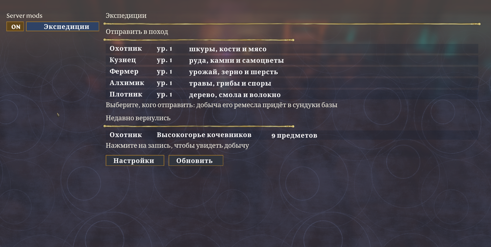

# Expeditions for Enshrouded

Send a survivor of your base on an expedition. They walk out past the edge of the base,
and when the time is up they come back with loot of their trade straight into the base's
chests. A server mod for [shroudlink](https://github.com/bjck/shroudlink); works in
singleplayer through shroudlink's singleplayer package.



**[Download the latest release](https://github.com/GronGM/enshrouded-expeditions/releases/latest)** ·
English and Russian · MIT

## What it does

| | |
|---|---|
| **Trades** | Blacksmith: ore, stone and gems. Carpenter: wood, resin and fibre. Hunter: hides, bones and meat. Alchemist: herbs, mushrooms and spores. Farmer: crops, grain and wool. Fisher: fish. |
| **Routes** | One per region (Springlands to Cinder's Cradle), each with its own loot and danger. A route opens once you have been to its region yourself. |
| **Rations** | 2 portions of food an hour from the base's chests: plain food, roasted food (+10% loot) or dishes (+25%). The plainest food of the kind goes first; herbs, eggs, raw meat and bait are never taken. |
| **Experience** | Time away levels a survivor up: +6% loot and -7% risk a level, more caches. Up to level 10. |
| **Events** | A cache (x1.5), a rich spot (x1.25), bad weather (x0.8), an injury (x0.5). The risk is shown before sending. |
| **Repeat** | The survivor delivers and sets out again on the same route. |
| **Panel and reports** | A panel on the screen with everyone away; a report with the items of every trip. |
| **Settings** | Every feature can be switched off in the game; durations, routes, loot and dangers live in `expeditions_config.json`. |

The loot is created by the game's own item functions (shroudlink `give_items`); rations are
taken with `remove_items`. The survivor's home point is moved out of the base while away and
put back when they return.

## Install

1. [shroudlink](https://www.nexusmods.com/enshrouded/mods/278): in singleplayer
   `shroudlink-singleplayer.zip` into the game folder; on a server the core, and the addon
   (`dinput8.dll`) for players.
2. `expeditions-1.2.0.zip` into the game folder (or the server's folder):
   `shroudlink_mods\expeditions.dll`.
3. With [The Worst Map Mod](https://www.nexusmods.com/enshrouded/mods/220) or another
   Greeneye Loader mod: also `expeditions-mapmod-compat-1.1.0.zip`, also on Nexus as
   [shroudlink first](https://www.nexusmods.com/enshrouded/mods/321)
   (`greeneye\0-shroudlink-first`). Without it the game can crash on entering the world,
   see [compat/shroudlink-first](compat/shroudlink-first/src/shroudlink_first.cpp).
4. In the game: **K** (MODS) > **Expeditions**.

Made and tested in singleplayer. On a dedicated server it runs like any shroudlink server mod
(each player needs the addon to see the window); that setup is not tested yet.

Player guides: [English](dist/README-expeditions.txt) · [Русский](dist/README-expeditions-ru.txt).

### With ShroudForge

[ShroudForge](https://www.nexusmods.com/enshrouded/mods/147) and shroudlink both start
through the game folder's `dinput8.dll`. ShroudForge can load shroudlink's as one of its
native DLL mods: `shroudlink-in-shroudforge-1.0.0.zip` gives `mods\shroudlink\native-plugin.ini`,
shroudlink's `dinput8.dll` goes next to it, `shroudlink_core.dll` and `shroudlink_mods\` stay
in the game folder. With Greeneye Loader mods, move ShroudForge's `dbghelp.dll` out of the
game folder and use shroudlink first 1.1.0 (ShroudForge's `dbghelp.dll` makes the Greeneye
Loader start its mods inside the Windows loader, before shroudlink can hook the game's UI).
Guide: [README-shroudlink-in-shroudforge.txt](dist/shroudforge/README-shroudlink-in-shroudforge.txt).
Tested in singleplayer with ShroudForge 1.7.9.

### With EMF instead of shroudlink

The same mod is also built for [EMF](https://www.nexusmods.com/enshrouded/mods/246) (Enshrouded
Modding Framework, 0.5.0 or newer; with UAC off see "If EMF's console does not open" in the guide): `expeditions-emf-1.2.0.zip` into the game folder
(`emf\mods\expeditions\`). **F10** (or `expeditions` in EMF's console) opens the window; the key is
in EMF's Mods tab. It runs in the game that runs the world (singleplayer or a world you host). Keep
only one of the two versions installed. Guides: [English](dist/README-expeditions-emf.txt) ·
[Русский](dist/README-expeditions-emf-ru.txt).

## Build

The mod is C++20 against shroudlink's C ABI (`src/sdk.h`, ABI v8, HostApi v7+).

```sh
pip install ziglang          # a Windows cross compiler (zig c++)
./build_win.sh               # build/expeditions.dll (shroudlink), build/emf/expeditions.dll (EMF)
./build_test.sh              # the tests (g++, a fake world, sanitizers), also against a fake EMF core
./package.sh                 # build/release/*.zip
compat/shroudlink-first/build_win.sh
compat/shroudlink-first/run_tests.sh   # needs Wine
```

| Path | |
|---|---|
| `src/expeditions.cpp` | the mod: expeditions, windows, rations, events, levels, regions |
| `src/dll.cpp` | the `shroudlink_mod_v2` export |
| `src/emf_main.cpp`, `src/emf_host.cpp` | the EMF build: `emf_mod_load`, shroudlink's HostApi on top of EMF's C API |
| `src/emf_ui.cpp` | the mod's windows as EMF mod windows (widgets, clicks, HUD lines) |
| `src/item_names.cpp` | readable item names (EN/RU) for the EMF windows |
| `src/defaults.h` | the default `expeditions_config.json` |
| `src/lang.cpp` | Russian and English texts and names |
| `src/page_text.cpp` | widths for the MODS page (Cyrillic is wider than the page assumes) |
| `src/regions.cpp`, `third_party/greeneye_regions.h` | which region a position is in |
| `src/supplies.cpp` | which items are rations |
| `tests/` | tests against a fake shroudlink host and a fake EMF core; `emf_smoke.cpp` loads the EMF DLL in Wine |
| `compat/shroudlink-first/` | the Greeneye Loader mod that orders the startup hooks |

## Русский

Отправьте выжившего с базы в поход: он уйдёт за пределы базы и вернётся с добычей своего
ремесла прямо в сундуки базы. Мод для [shroudlink](https://github.com/bjck/shroudlink),
работает и в одиночной игре. Припасы из сундуков, опыт и уровни выживших, события в пути,
маршруты открываются по мере исследования мира, повтор похода, панель на экране и отчёты.
Интерфейс на русском и английском. Установка и описание: [README-expeditions-ru.txt](dist/README-expeditions-ru.txt).

## Credits

Made by GronGM. Third-party material and licenses: [THIRD_PARTY.md](THIRD_PARTY.md).
Enshrouded is a game by Keen Games; this project is not affiliated with Keen Games.
